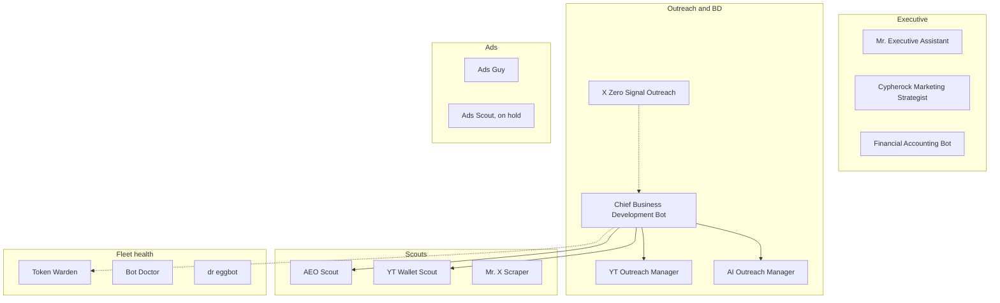

# Cypherock Growth OS

Cypherock builds a hardware crypto wallet. This repository is the operating manual for the Grok Bots that run its marketing and business development: who each agent is, when it speaks, what it may send, and what it must leave alone.

Fifteen bots. Personas, schedules, and approval gates. There is no campaign code here and no results dashboard. A number appears only when a live profile or a dated note already stated it.

**Roster as of 2026-11-24.** Profile text is from live exports on 2026-11-22. Ads Scout has been on hold since 2026-09-22. The other fourteen are operational.

## The fleet

Chief Business Development Bot’s profile names the four bots on solid arrows, and Token Warden as the partner it asks before it throttles a lane. The dashed arrow from X Zero Signal Outreach is that bot’s own line: it reports to Chief BD. Chief BD’s export does not list X Zero.

Mr. X Scraper, the ads bots, and the executive layer do not report to Chief BD in these exports. Ads Scout is on hold. Bot Doctor and dr eggbot are on demand. They have no standing schedule in their profiles.

Two profiles, X Zero Signal Outreach and Cypherock Marketing Strategist, say Cypherock is not a seedless wallet and must not be described as one. The strategist’s profile names the flagship as Cypherock X1. X Zero’s profile names the product it sells as Cypherock X Zero.

## Roster

### Outreach and BD

| Bot | Folder | What it does | Status |
|-----|--------|----------------|--------|
| [Chief Business Development Bot](bots/chief-business-development-bot/README.md) | `chief-business-development-bot` | Runs the outreach and scout lanes. Keeps approval gates. Asks Token Warden before a throttle. Does not send the mail itself. | 🟢 Operational |
| [YT Outreach Manager · YouTube Outreach](bots/yt-outreach-manager/README.md) | `yt-outreach-manager` | YouTube creator outreach. Send only after approval, at local business hours. | 🟢 Operational |
| [AI Outreach Manager](bots/ai-outreach-manager/README.md) | `ai-outreach-manager` | Publisher outreach from AEO Scout. Gmail only after an explicit OK. | 🟢 Operational |
| [X Zero Signal Outreach](bots/x-zero-signal-outreach/README.md) | `x-zero-signal-outreach` | LinkedIn and email for Cypherock X Zero, when a buying signal scores 2 or higher. Templates need approval first. | 🟢 Operational |

### Intelligence and scouts

| Bot | Folder | What it does | Status |
|-----|--------|----------------|--------|
| [AEO Scout](bots/aeo-scout/README.md) | `aeo-scout` | Daily AI-search visibility. Builds a prospect database for AI Outreach Manager. | 🟢 Operational |
| [YT Wallet Scout](bots/yt-wallet-scout/README.md) | `yt-wallet-scout` | Daily hardware-wallet YouTube scans, creator discovery, and outreach-ready scores. | 🟢 Operational |
| [Mr. X Scraper](bots/mr-x-scraper/README.md) | `mr-x-scraper` | Live profile: a marketing-tools hint. September playbook, not in that export: an X cold-wallet comment dig, Mon–Sat 16:00 IST. | 🟢 Operational |

### Ads

| Bot | Folder | What it does | Status |
|-----|--------|----------------|--------|
| [Ads Guy · Performance Marketing](bots/ads-guy/README.md) | `ads-guy` | Own-account Google Ads. Daily at 8:00 AM IST. Executes only after explicit approval. | 🟢 Operational |
| [Ads Scout · Competitive Ads](bots/ads-scout/README.md) | `ads-scout` | Watches the public Google ads library. | ⏸️ On hold since 2026-09-22 |

### Strategy and ops

| Bot | Folder | What it does | Status |
|-----|--------|----------------|--------|
| [Mr. Executive Assistant](bots/mr-executive-assistant/README.md) | `mr-executive-assistant` | Weekday morning inbox and calendar. Drafts replies. Sends only when told to send that reply. | 🟢 Operational |
| [Cypherock Marketing Strategist](bots/cypherock-marketing-strategist/README.md) | `cypherock-marketing-strategist` | Evidence-led plans for SEO, AEO, GEO, and the rest of marketing. Does not send, post, or touch ads. | 🟢 Operational |
| [Financial Accounting Bot](bots/financial-accounting-bot/README.md) | `financial-accounting-bot` | One paid-marketing ledger. Records what it is told. Does not move money. | 🟢 Operational |

### Fleet health

| Bot | Folder | What it does | Status |
|-----|--------|----------------|--------|
| [Token Warden](bots/token-warden/README.md) | `token-warden` | Fleet token accountant. Proposes cuts. Answers Chief BD’s headroom asks. | 🟢 Operational |
| [Bot Doctor](bots/bot-doctor/README.md) | `bot-doctor` | On-demand diagnosis when a bot is silent, hung, or failing to send. One poke, then a proposed fix. | 🟢 Operational |
| [dr eggbot](bots/dr-eggbot/README.md) | `dr-eggbot` | On-demand bot designer. A few preference questions, then it creates the bot. | 🟢 Operational |

Three folders keep the shorter slug from the earlier docs: `ads-guy`, `ads-scout`, and `yt-outreach-manager`. The table uses the live names.

## How it works

**A person approves a send.** YT Outreach and AI Outreach draft, then wait for an explicit yes. Ads Guy recommends, then executes only after explicit approval. Mr. Executive Assistant sends mail only when Abhinav says to send that reply. X Zero Signal Outreach is the exception written into its profile: the first templates need approval, and after that a message built from an approved template can go without a per-message ask. A new template, a changed offer, or a reply still waits.

**Fleet changes are proposed.** Token Warden recommends a cut and messages another bot only after a yes in its own chat. It does answer Chief BD on headroom. That path is in the 2026-11-22 profile. Bot Doctor may poke the one named stuck bot, and it does not edit a profile or a routine without a yes to that exact change. The marketing strategist plans, and stops before creating or messaging a bot.

**Silence is a feature.** Token Warden, Mr. Executive Assistant, the financial ledger’s Monday nudge, X Zero’s daily line, and the strategist’s weekly note are told to stay quiet when nothing changed, and not to send “(no change.)”. Some 2026-09-17 cuts added the same rule to scouts. Where the new export does not repeat it, the bot’s folder says so.

**Clocks are IST** (Asia/Calcutta). Mr. X Scraper’s September playbook uses Asia/Kolkata, the same offset. A clock that was not in an export is labeled, and no cron string is invented to fill it.

**Tokens are watched, and not invented.** Token Warden tracks cadence waste and subscription limits. Chief BD asks Token Warden before it throttles a scout or protects an outreach quota. This repo does not publish a usage number newer than the 2026-09-17 snapshot in Token Warden’s notes. If a limit is missing, the bots are told to say so.

## Where to read next

[bots/README.md](bots/README.md) is the filing manual: required files, what must never be committed, and the shared words (`propose-only`, `silent-delta`, `volume class`).

Open a bot’s `README.md`, then `PROFILE.md`. The `profile.json` beside it is the sanitized export, for a restore.
