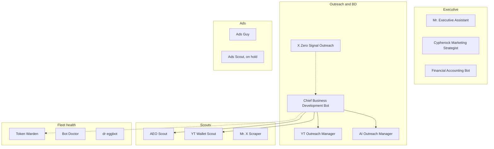

# Grok Bots

This folder is the durable source of truth for Cypherock’s Grok Bots: who each bot is, how it runs, what it must never do, and what changed.

Cypherock builds a hardware crypto wallet. These agents run its marketing and business development. Live bots on the box can be lost, renamed, or recreated. The files here should be enough for another human or agent to **restore**, **operate**, and **audit** them without relying on chat memory.

There is no marketing-automation code in this tree. Personas and ops notes only.

**Roster as of 2026-11-24.** Every profile below is backed by a live export from 2026-11-22 (`profile.json` in the bot folder). Ads Scout is on hold. The other fourteen are operational.

## The fleet

Solid arrows are the four bots Chief Business Development Bot’s profile says it runs. The dashed arrow into Chief BD is X Zero Signal Outreach’s own reporting line. Chief BD’s export does not list X Zero. The dashed arrow to Token Warden is the headroom check, not a reporting line. Everyone else in the chart has no command edge in these exports. Ads Scout is on hold.

## Roster

### Outreach and BD

| Bot | Folder | What it does | Status |
|-----|--------|----------------|--------|
| [Chief Business Development Bot](chief-business-development-bot/README.md) | `chief-business-development-bot` | Runs the outreach and scout lanes. Keeps approval gates. Asks Token Warden before a throttle. Does not send the mail itself. | 🟢 Operational |
| [YT Outreach Manager · YouTube Outreach](yt-outreach-manager/README.md) | `yt-outreach-manager` | YouTube creator outreach. Send only after approval, at local business hours. | 🟢 Operational |
| [AI Outreach Manager](ai-outreach-manager/README.md) | `ai-outreach-manager` | Publisher outreach from AEO Scout. Gmail only after an explicit OK. | 🟢 Operational |
| [X Zero Signal Outreach](x-zero-signal-outreach/README.md) | `x-zero-signal-outreach` | LinkedIn and email for Cypherock X Zero, when a buying signal scores 2 or higher. Templates need approval first. | 🟢 Operational |

### Intelligence and scouts

| Bot | Folder | What it does | Status |
|-----|--------|----------------|--------|
| [AEO Scout](aeo-scout/README.md) | `aeo-scout` | Daily AI-search visibility. Builds a prospect database for AI Outreach Manager. | 🟢 Operational |
| [YT Wallet Scout](yt-wallet-scout/README.md) | `yt-wallet-scout` | Daily hardware-wallet YouTube scans, creator discovery, and outreach-ready scores. | 🟢 Operational |
| [Mr. X Scraper](mr-x-scraper/README.md) | `mr-x-scraper` | Live profile: a marketing-tools hint. September playbook, not in that export: an X cold-wallet comment dig, Mon–Sat 16:00 IST. | 🟢 Operational |

### Ads

| Bot | Folder | What it does | Status |
|-----|--------|----------------|--------|
| [Ads Guy · Performance Marketing](ads-guy/README.md) | `ads-guy` | Own-account Google Ads. Daily at 8:00 AM IST. Executes only after explicit approval. | 🟢 Operational |
| [Ads Scout · Competitive Ads](ads-scout/README.md) | `ads-scout` | Watches the public Google ads library. | ⏸️ On hold since 2026-09-22 |

### Strategy and ops

| Bot | Folder | What it does | Status |
|-----|--------|----------------|--------|
| [Mr. Executive Assistant](mr-executive-assistant/README.md) | `mr-executive-assistant` | Weekday morning inbox and calendar. Drafts replies. Sends only when told to send that reply. | 🟢 Operational |
| [Cypherock Marketing Strategist](cypherock-marketing-strategist/README.md) | `cypherock-marketing-strategist` | Evidence-led plans for SEO, AEO, GEO, and the rest of marketing. Does not send, post, or touch ads. | 🟢 Operational |
| [Financial Accounting Bot](financial-accounting-bot/README.md) | `financial-accounting-bot` | One paid-marketing ledger. Records what it is told. Does not move money. | 🟢 Operational |

### Fleet health

| Bot | Folder | What it does | Status |
|-----|--------|----------------|--------|
| [Token Warden](token-warden/README.md) | `token-warden` | Fleet token accountant. Proposes cuts. Answers Chief BD’s headroom asks. | 🟢 Operational |
| [Bot Doctor](bot-doctor/README.md) | `bot-doctor` | On-demand diagnosis when a bot is silent, hung, or failing to send. One poke, then a proposed fix. | 🟢 Operational |
| [dr eggbot](dr-eggbot/README.md) | `dr-eggbot` | On-demand bot designer. A few preference questions, then it creates the bot. | 🟢 Operational |

`ads-guy`, `ads-scout`, and `yt-outreach-manager` keep those folder slugs. The live names are longer, and the table uses them. Do not rename the folders to match.

Scan-time volume classes and the 2026-09-17 cuts stay in Token Warden’s [FLEET-BASELINE.md](token-warden/FLEET-BASELINE.md). Those rows are historical. Where a 2026-11-22 export does not repeat a cut, the bot folder says the cut is not in the export.

## How it works

**A person approves a send.** YT Outreach and AI Outreach draft, then wait for an explicit yes. Ads Guy recommends, then executes only after explicit approval. Mr. Executive Assistant sends mail only when Abhinav says to send that reply. X Zero Signal Outreach is the exception in its own profile: templates need approval first, and a message built from an approved template can then go without a per-message ask. A new template, a changed offer, or a reply still waits.

**Fleet changes are proposed.** Token Warden recommends a cut and messages another bot only after a yes in its own chat. It answers Chief BD’s headroom asks without that yes. That path is in the 2026-11-22 profile. Bot Doctor may poke the one named stuck bot. A profile or routine edit waits for a yes to that exact change.

**Silence is a feature.** Several profiles say to stay quiet when nothing changed, and never to send “(no change.)”. Where an older cut added that rule and the new export does not repeat it, the bot folder keeps the cut and labels it.

**Clocks are IST** (Asia/Calcutta), unless a bot’s PROFILE says otherwise. Mr. X Scraper’s playbook uses Asia/Kolkata, the same offset. A missing clock stays missing. Do not invent a cron string.

**Tokens are watched, and not invented.** Token Warden owns cadence waste and subscription limits. Chief BD asks Token Warden before a throttle. This repo does not invent usage numbers. The last recorded snapshot is 2026-09-17, in Token Warden’s usage note.

## Why this structure exists

1. **Recreate / restore** a bot from `PROFILE.md` + `OPERATIONS.md` (and `profile.json` when present) if the live bot is lost.
2. **Onboard the next bot** by copying `_template/` instead of reinventing file names and sections.
3. **Audit trail** of fleet cuts and dated baselines for Monday deep dives.
4. **Shared vocabulary** (`volume class`, `silent-delta`, `propose-only`) so marketing bots describe waste the same way.
5. **Handoff:** someone else can operate a bot from these files alone.
6. **Later (optional):** a CI/lint check that every `bots/<slug>/` has the required files. Not implemented.

## How to add a bot

1. Copy `bots/_template/` → `bots/<slug>/`. Slug is kebab-case of the live bot name (`token-warden`, `mr-x-scraper`). The three shorter slugs above are exceptions. Do not rename them.
2. Fill every required file. Do not merge leftover `TODO` placeholders.
3. Add a row to the roster above, in the group the bot actually belongs to, with a status.
4. Log the documentation bootstrap in that bot’s `CHANGELOG.md`.
5. Extra files are allowed when the role needs them (Token Warden’s `USAGE-TRACKING.md`, `FLEET-BASELINE.md`, `baselines/`).

Do not create a folder for a bot that is only a rumor. Identity (name plus agent uuid, or a live profile export) has to be in hand first. Do not create empty stub folders.

## Required files (every bot)

| File | Purpose |
|------|---------|
| `README.md` | One-pager: purpose, owner, when to use, links |
| `PROFILE.md` | Canonical persona — voice, cadence, anti-jobs |
| `OPERATIONS.md` | How it runs: schedules (IST unless PROFILE says otherwise), folders, scan paths, propose vs execute |
| `ANTI-JOBS.md` | Hard never-list (ops-facing; must match PROFILE) |
| `CHANGELOG.md` | Dated decisions and applied changes |

Recommended extras:

| File | When |
|------|------|
| `profile.json` | Live Grok Bot profile export — restore aid. Every bot in the roster above has one, from 2026-11-22. |
| `baselines/YYYY-MM-DD.md` | Dated scans; do not overwrite, add a new date |

## Conventions

- **Timezone:** IST (`Asia/Calcutta`) unless the bot’s PROFILE says otherwise.
- **No secrets:** never commit API keys, cookies, session tokens, or third-party credentials.
- **No personal or account data:** never commit contact lists, message bodies, ad-account ids, spend, campaign structures, or connector tokens. Role, cadence, and anti-jobs belong here. Operating data stays on the bot computer.
- **No invented identity:** if harness, cron expression, avatar, or profile text was not exported, say so. A restore draft must be labeled as a draft.
- **No invented usage numbers:** if Usage & Billing / telemetry is missing, say what is missing and what you need.
- **Volume class is not a token count.** It is qualitative activity (workdir churn + stated cadence).
- **Propose-only** unless that bot’s OPERATIONS says it may act after an explicit user yes in *its* chat.
- Update `CHANGELOG.md` the same day a live change is approved.

## Shared vocabulary

| Term | Meaning |
|------|---------|
| **volume class** | Activity band (`high` / `med-high` / `med` / `low`) from workdir + cadence evidence. Not tokens. |
| **silent-delta** | Speak only when there is a material change vs baseline. Never send “(no change.)”. |
| **propose-only** | Recommend a cut; do not mute/pause/edit/message other bots until explicit user yes in that bot’s chat. |
| **relative waste** | Cadence / overlap / empty-run waste you can flag without a usage API. |
| **spend-vs-cap** | Usage vs weekly/total subscription limits — only with a fresh Usage & Billing snapshot. |
| **SendToAgent** | After user yes, Token Warden messages the target bot to apply a cut. It cannot edit other bots’ routines directly. |
